# GitHub Desktop 分支管理实战学习指南

> 通过一次**真实操作、逐步截图、核对结果**，学习 `main`、开发分支、Commit、Publish/Push、Pull Request、Merge、删除分支、Fetch/Pull、Tag 和 Release。  
> 示例仓库：[coowinit/github-desktop-learning-guide](https://github.com/coowinit/github-desktop-learning-guide)  
> 实验日期：2026-10-14 · 系统：Windows / GitHub Desktop / PowerShell  
> 实验分支：`docs/branch-workflow-demo` · Pull Request：[PR #1](https://github.com/coowinit/github-desktop-learning-guide/pull/1)  
> 实验发布：[v0.1.0-workflow-demo](https://github.com/coowinit/github-desktop-learning-guide/releases/tag/v0.1.0-workflow-demo)（Pre-release）

**阅读方式**：每一步先看真实截图，理解实际点击的操作，再阅读“原理与验证”。本指南保留原始操作顺序，不把不同阶段的截图拼接成虚构的界面。截屏中的按钮和布局可能随 GitHub 更新而变化。

## 目录

1. [实验目标与总体流程](#1-实验目标与总体流程)
2. [创建本地开发分支](#2-创建本地开发分支)
3. [修改文件与两次 Commit](#3-修改文件与两次-commit)
4. [Publish Branch 与 Push](#4-publish-branch-与-push)
5. [创建与检查 Pull Request](#5-创建与检查-pull-request)
6. [Merge 并验证 main](#6-merge-并验证-main)
7. [删除远程与本地开发分支](#7-删除远程与本地开发分支)
8. [排障：origin/ 分支为什么仍显示](#8-排障origin-分支为什么仍显示)
9. [确认主分支已同步](#9-确认主分支已同步)
10. [创建 Tag 与 Release](#10-创建-tag-与-release)
11. [九个核心概念对照](#11-九个核心概念对照)
12. [实际工作中的推荐流程](#12-实际工作中的推荐流程)
13. [容易犯的错误与风险](#13-容易犯的错误与风险)
14. [验收清单与命令速查](#14-验收清单与命令速查)
15. [截图索引与参考链接](#15-截图索引与参考链接)

---

## 1. 实验目标与总体流程

本次实验不是在真实产品仓库中反复尝试危险命令，而是在独立的学习仓库里操作完整闭环：

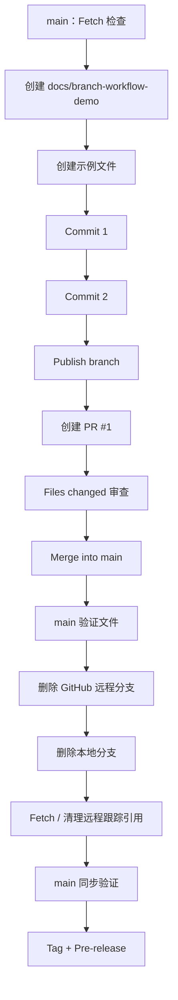

**分支最重要的定义**：Git Branch 是指向一个 Commit 的可移动引用，不是复制了一个独立文件夹。`main` 和开发分支可以从同一 Commit 起步，后来各自指向不同的提交。

## 2. 创建本地开发分支

### 2.1 检查 main 与工作区

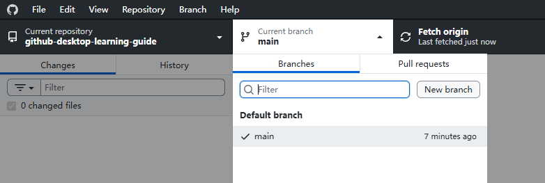

操作：GitHub Desktop → `Current repository` 选择学习仓库 → `Current branch` 选择 `main` → `Fetch origin` → 检查 `Changes`。

截图显示 `main`、`0 changed files` 和刚完成的 Fetch。**工作区干净不等于本地与 GitHub 必然同步**，还需要观察是否有 `Pull origin` / `Push origin`。

### 2.2 新建分支

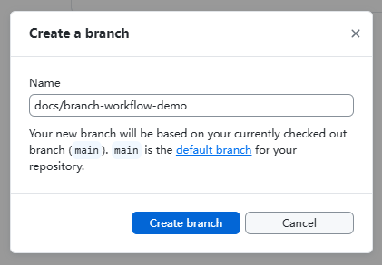

操作：`Current branch` → `New branch`，输入 `docs/branch-workflow-demo`，以当前 `main` 为基础，点击 `Create branch`。

`docs/` 只是分支命名约定，并非真正的目录；`main` 是新分支的起点。

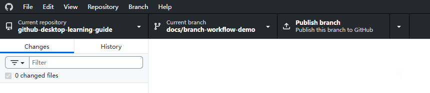

创建后 `Current branch` 显示新分支，顶部出现 `Publish branch`。**这是本地分支，尚未发布到 GitHub**。此时两个本地分支可以仍然指向同一 Commit。

## 3. 修改文件与两次 Commit

### 3.1 新建 Markdown 示例文件

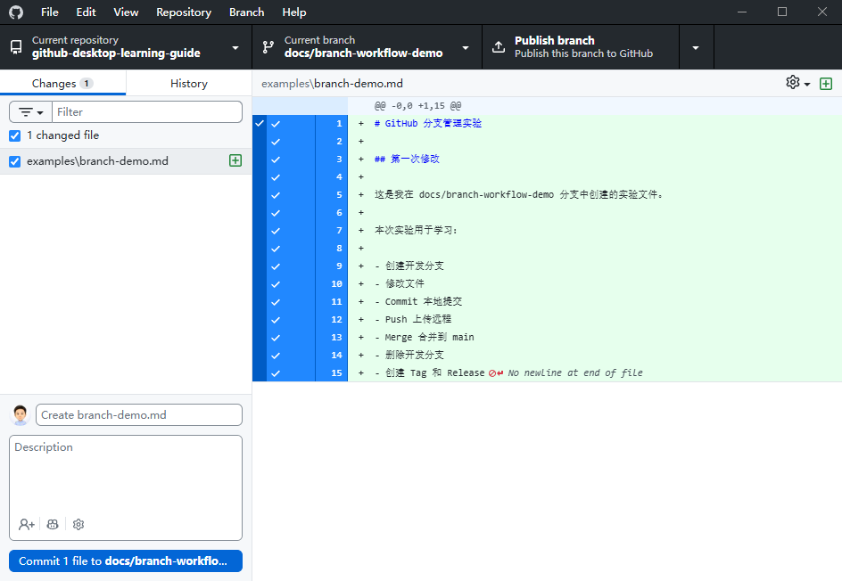

操作：`Repository → Show in Explorer`，新建 `examples/branch-demo.md`，填写第一次实验内容并保存。返回 Desktop，左侧 `1 changed file`、绿色新增行说明工作区发生变化。

> 概念区别：保存文件仅改变工作区；**Commit** 才在本地 Git 历史中记录这些更改；**Push** 才上传至 GitHub。

### 3.2 第一次 Commit

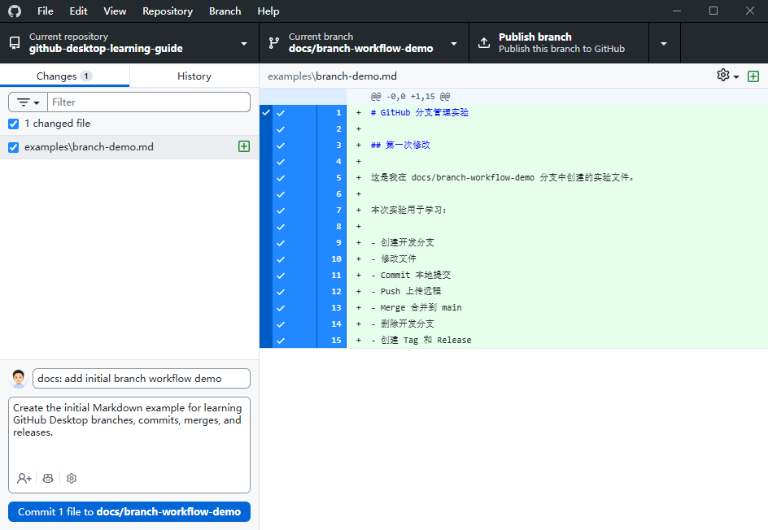

填写：

- Summary：`docs: add initial branch workflow demo`
- Description：`Create the initial Markdown example for learning GitHub Desktop branches, commits, merges, and releases.`

点击 `Commit 1 file to docs/branch-workflow-demo`。Summary 是简短标题，Description 可以选填；提交只作用于当前分支。

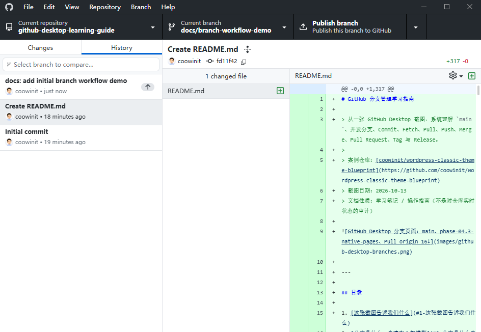

History 显示刚刚新增的 Commit。截图右侧当时选中的是旧的 `Create README.md`，因此右侧展示旧提交的差异——**History 点击哪条提交，右侧就展示哪一次修改**。

### 3.3 第二次 Commit

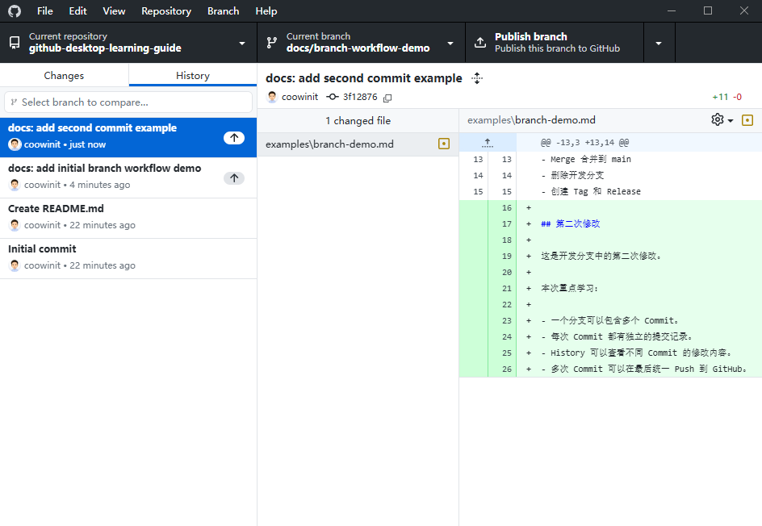

同一文件追加“第二次修改”内容，提交 Summary：`docs: add second commit example`。History 现在显示两条实验提交，右侧第二次提交新增 11 行。

**一个分支可以有多个 Commit**，不需要每次 Commit 后立刻 Push。实验中第一次新增 15 行、第二次新增 11 行，最终文件 26 行。

## 4. Publish Branch 与 Push

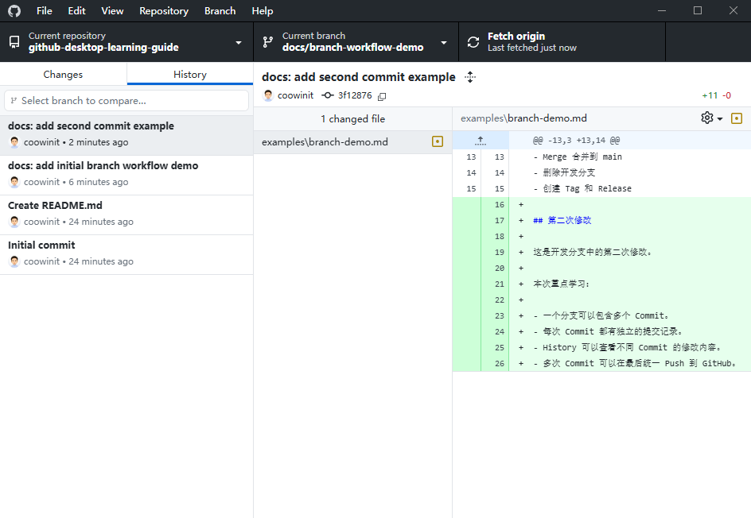

首次点击 `Publish branch`，远端才创建 `docs/branch-workflow-demo` 分支并接收两个 Commit。成功后顶部恢复 `Fetch origin`。

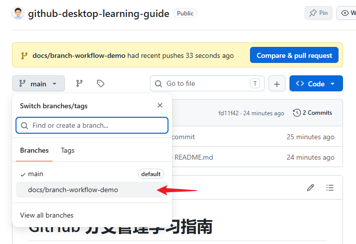

GitHub 网站上的分支下拉框同时显示 `main` 和 `docs/branch-workflow-demo`。黄色横幅的 `Compare & pull request` 表示可以发起合并申请。

| 名称 | 什么时候用 | 是否会改变 GitHub 远端 |
| --- | --- | --- |
| Publish branch | 本地分支第一次推送到 GitHub | 是，创建远程分支并上传提交 |
| Push origin | 已发布分支继续提交后 | 是，上传新的提交 |
| Fetch origin | 查询并获取远程新状态 | 否 |
| Pull origin | 将远程更新整合到本地当前分支 | 否（仅更新本地） |

**Publish 不等于 Merge**：此时 `main` 仍没有新增实验文件。

## 5. 创建与检查 Pull Request

### 5.1 PR 创建表单

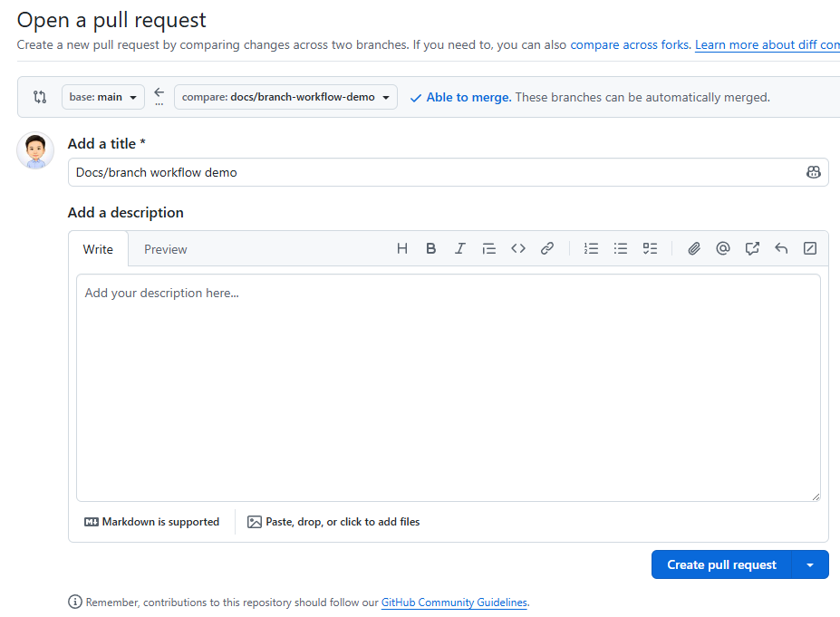

点击 `Compare & pull request`，确认：

- `base: main`：**目标分支**，准备接收改动；
- `compare: docs/branch-workflow-demo`：**来源分支**，提供改动；
- `Able to merge`：当前 GitHub 判断可自动合并，**不意味着功能测试已通过**。

PR Title 使用 `docs: add GitHub branch workflow demo`；Description 说明变更、验证记录和实验目的。点击 `Create pull request`。

### 5.2 PR 创建成功

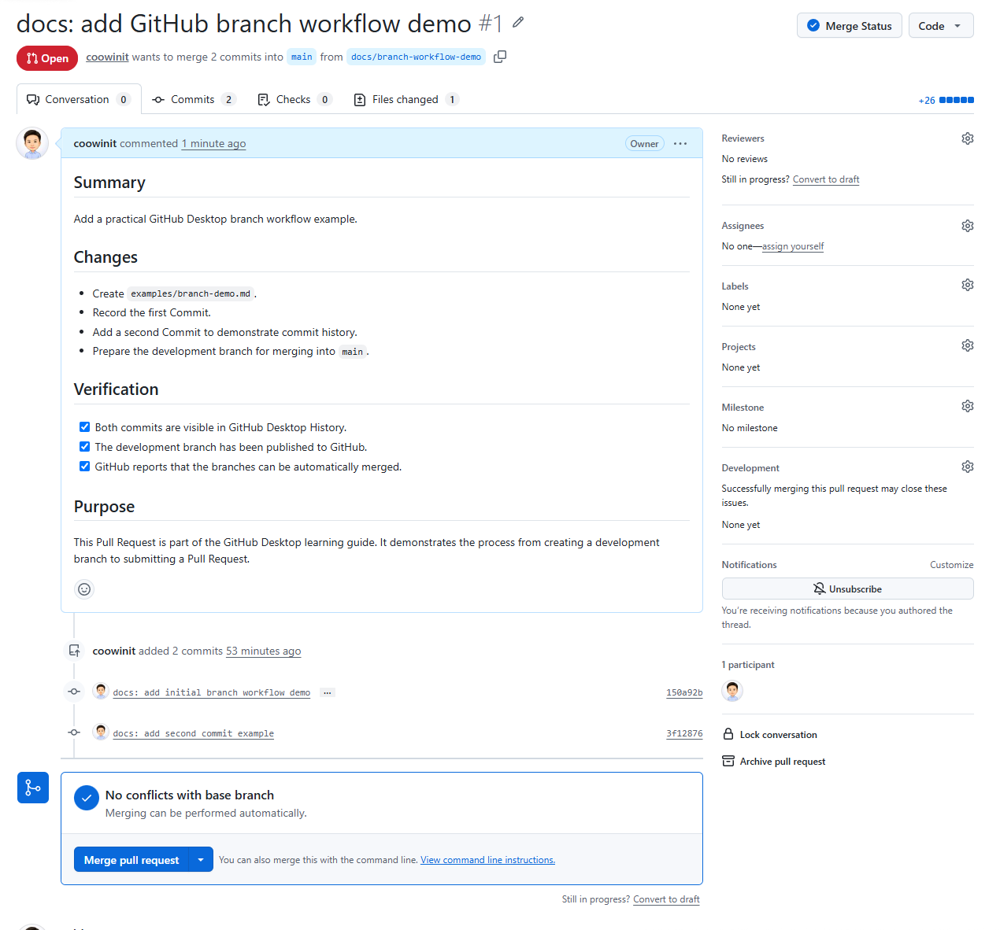

创建后的 [PR #1](https://github.com/coowinit/github-desktop-learning-guide/pull/1) 状态为 `Open`；包含 **2 Commits、1 Files changed、0 Checks**。`Checks 0` 代表本页没有列出检查，不能理解为自动化测试通过。

- **Conversation**：说明、评论、状态和合并事件。
- **Commits**：PR 包含的每次提交。
- **Checks**：工作流与检查结果（如有配置）。
- **Files changed**：PR 相对目标分支的累计代码差异。

### 5.3 审查累计文件差异

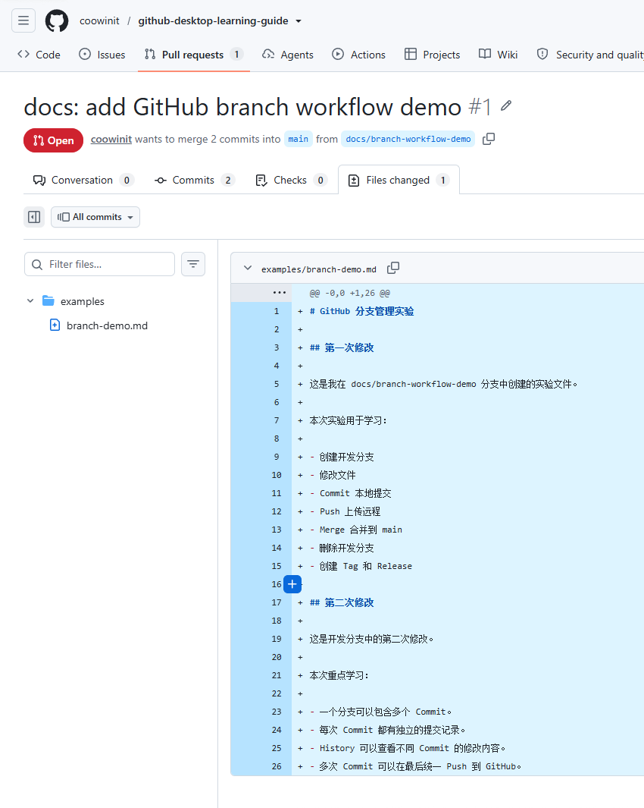

尽管开发过程进行了两次 Commit，PR 只显示 `examples/branch-demo.md` **1 个文件、新增 26 行**。这是相对于 `main` 的累计结果，不是要求每次 Commit 单独合并。

## 6. Merge 并验证 main

### 6.1 合并确认

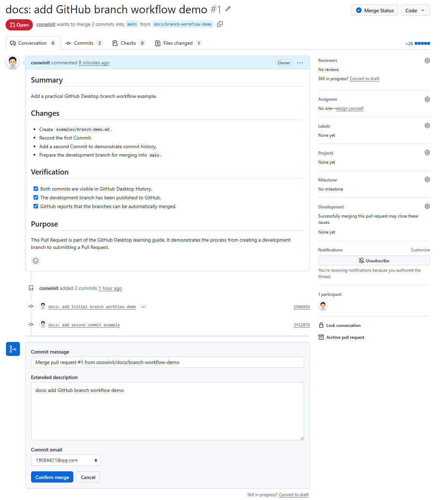

在 PR 的 Conversation 下点击 `Merge pull request`，出现确认界面。本实验保留默认合并信息，再点击 `Confirm merge`。截图中的邮箱信息已由本人遮挡。

默认的 **Create a merge commit** 会生成一个包含两条父历史的 Merge Commit，并保留开发分支原有两条 Commit；它不同于 Squash merge（压缩提交）或 Rebase merge（重放提交）。

### 6.2 合并成功

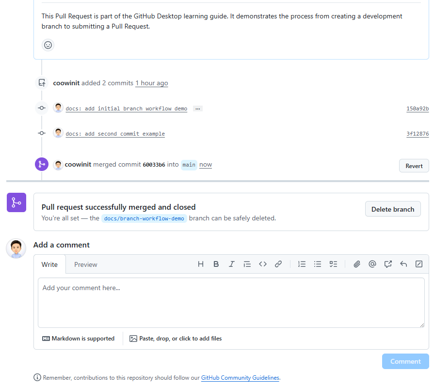

PR 记录 `merged commit 60033b6 into main`，状态为 `Merged and closed`，并出现 `Delete branch` 按钮。**合并与删除来源分支是两件独立的操作。**

### 6.3 直接验证 main 文件

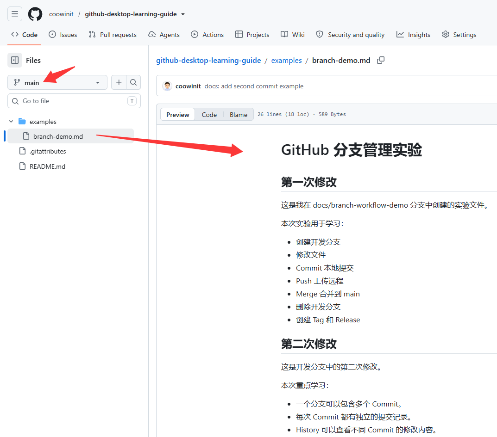

进入仓库 Code 页面，选择 `main`，打开 `examples/branch-demo.md`，确认第一、第二次修改内容均存在。这是比只看“合并成功”提示更直接的功能验证。

## 7. 删除远程与本地开发分支

### 7.1 删除 GitHub 远程分支

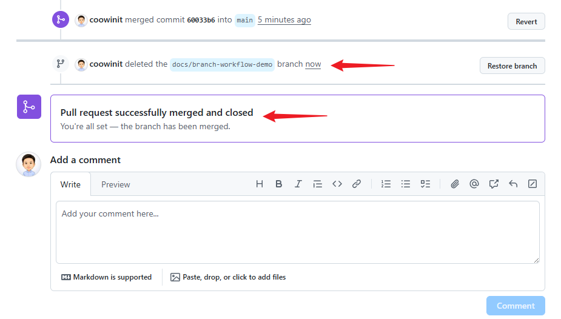

在已合并 PR 页面点击 `Delete branch`。GitHub 出现 `deleted the docs/branch-workflow-demo branch` 和 `Restore branch`。

此次只删除 GitHub 远端的分支引用；**已经进入 `main` 的 Commit、文件以及 PR 记录仍然保留**。`Restore branch` 在此 PR 中可用，但不是所有删除场景都保证能恢复。

### 7.2 本地仍有开发分支

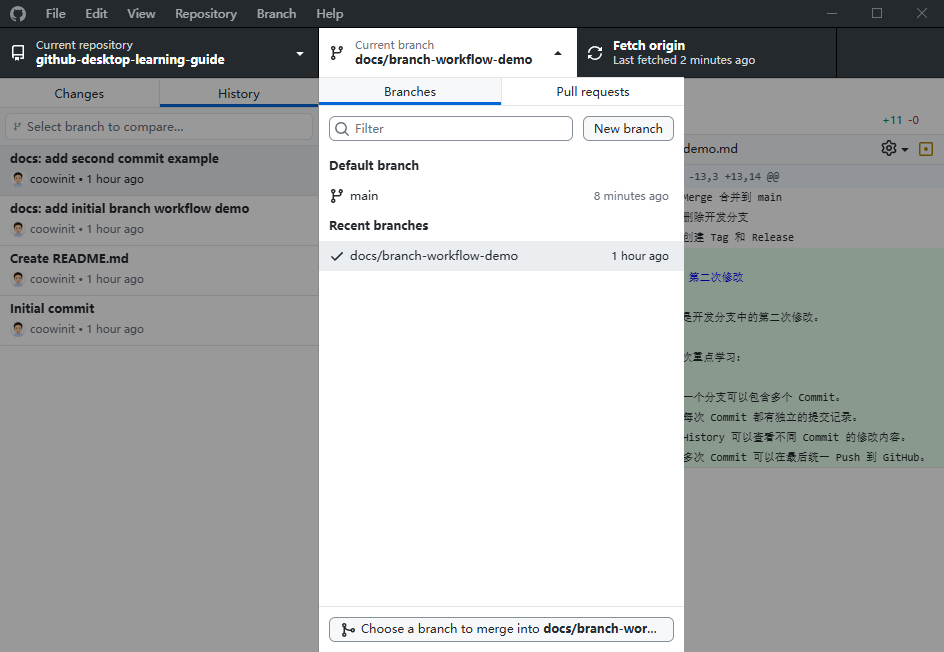

回到 Desktop：当前仍可看到本地 `docs/branch-workflow-demo`。远程删除不会立即替你删除本地分支。

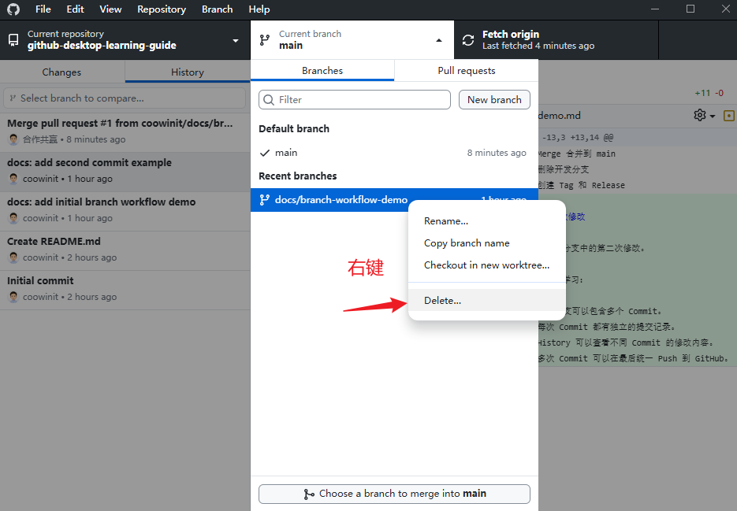

先切换到 `main`，右键原开发分支 → `Delete...`；不要尝试删除当前正在检出的分支。

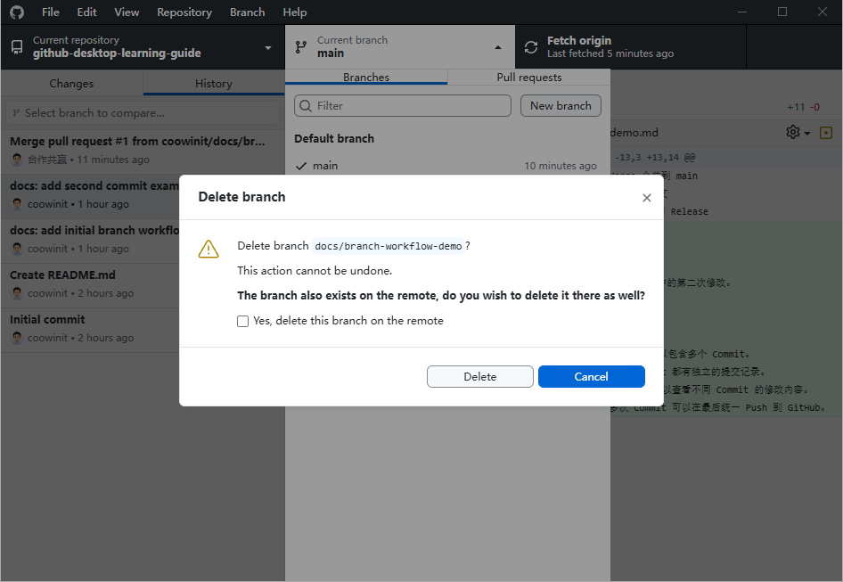

确认对话框显示 `This action cannot be undone` 以及可选的 `Yes, delete this branch on the remote`。因为远程分支已在 GitHub 网站上删除，**本次不勾选远程删除**，仅点击 Delete 删除本地分支。

> 谨慎：删除**未合并**分支可能使其独有提交失去易访问的引用。必须先确认 Merge 记录、重要文件和未保存改动。

## 8. 排障：origin/ 分支为什么仍显示

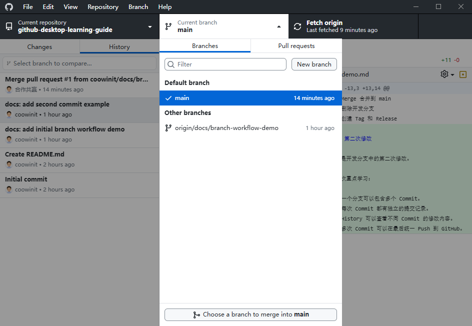

删除本地分支后，Desktop 仍列出 `origin/docs/branch-workflow-demo`。这是**远程跟踪引用**，不是已删除的本地分支，也不能据此证明 GitHub 网站上同名分支还在。

| 名称 | 存在地点 | 含义 |
| --- | --- | --- |
| `docs/branch-workflow-demo` | 本地仓库 | 本地开发分支（本次已删除） |
| `origin/docs/branch-workflow-demo` | 本地仓库 | 本地保存的远端分支位置记录（可能过期） |
| GitHub 网站上的同名分支 | GitHub 服务器 | 真正远程分支（本次已删除） |

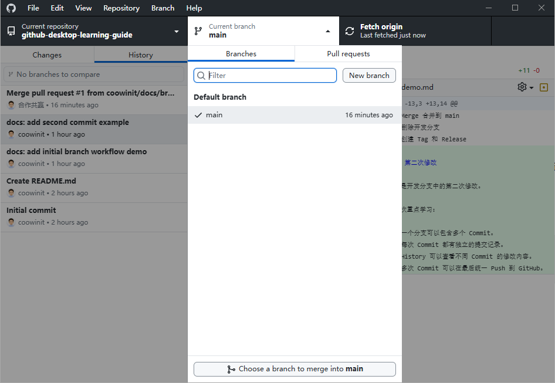

这次通过 Desktop 的 `Fetch origin`，`origin/docs/branch-workflow-demo` 已从列表消失。**这是观察到的实际顺序**，不应错误地说是后面的 PowerShell 命令才使其消失。

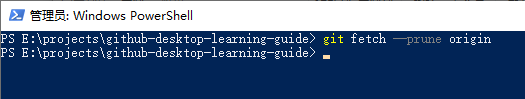

后续还在仓库目录中练习了：

```powershell
git fetch --prune origin
```

`fetch` 获取更新，`--prune` 清理远程已不存在的**远程跟踪引用**，`origin` 是远程仓库名称。它不会删除已合并到 `main` 的文件，也不会删除普通本地开发分支。此命令不需要管理员 PowerShell。

## 9. 确认主分支已同步

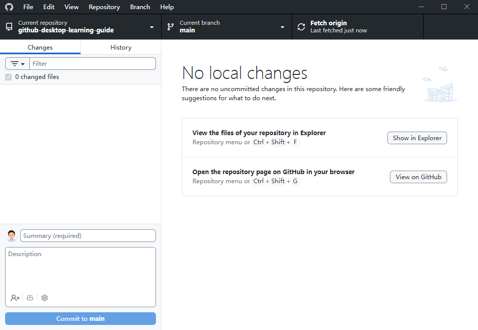

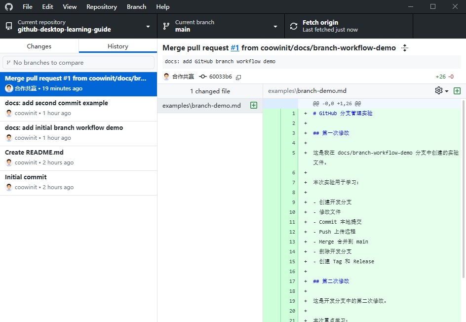

这次检查三件事：

1. **工作区状态**：`Changes → 0 changed files`。
2. **同步状态**：Fetch 后顶部没有待处理的 `Pull origin` / `Push origin` 提示。
3. **历史状态**：`History` 包含 `60033b6` Merge Commit 和两次实验提交。

History 列表按显示顺序排列不等于 Git 提交图完全是一条直线，Merge Commit 有两条父历史。

## 10. 创建 Tag 与 Release

### 10.1 在 Release 中选择新 Tag

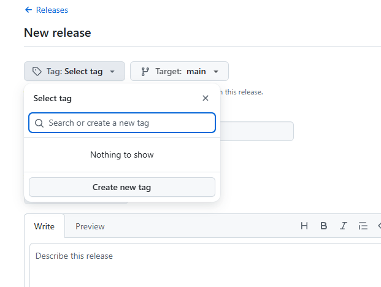

GitHub 仓库 → `Releases` → `Draft a new release` → `Select tag`。初次没有历史 Tag 时显示 `Nothing to show`。

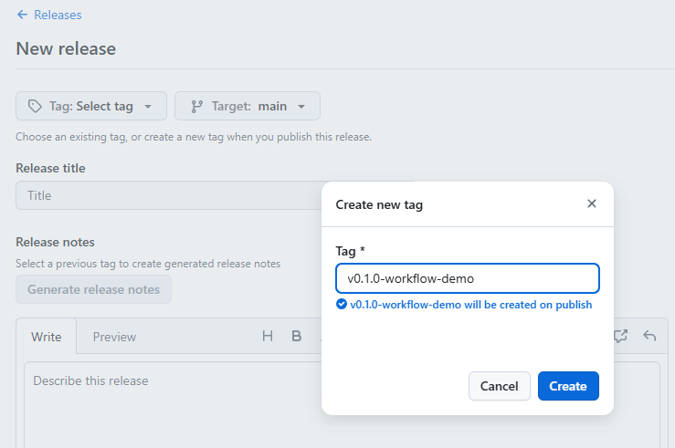

填写 `v0.1.0-workflow-demo`，点击 `Create`。页面提示 **Tag will be created on publish**；这时只是待创建 Tag 配置。

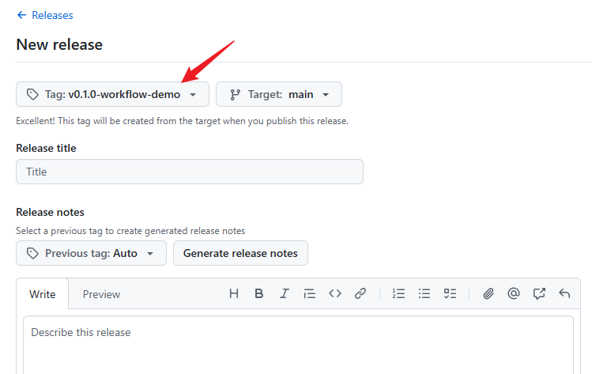

Target 选择 `main`。这里表示**发布时从当时目标分支指向的 Commit 创建 Tag**，不是永远追踪 `main` 的未来变化。

### 10.2 填写 Pre-release

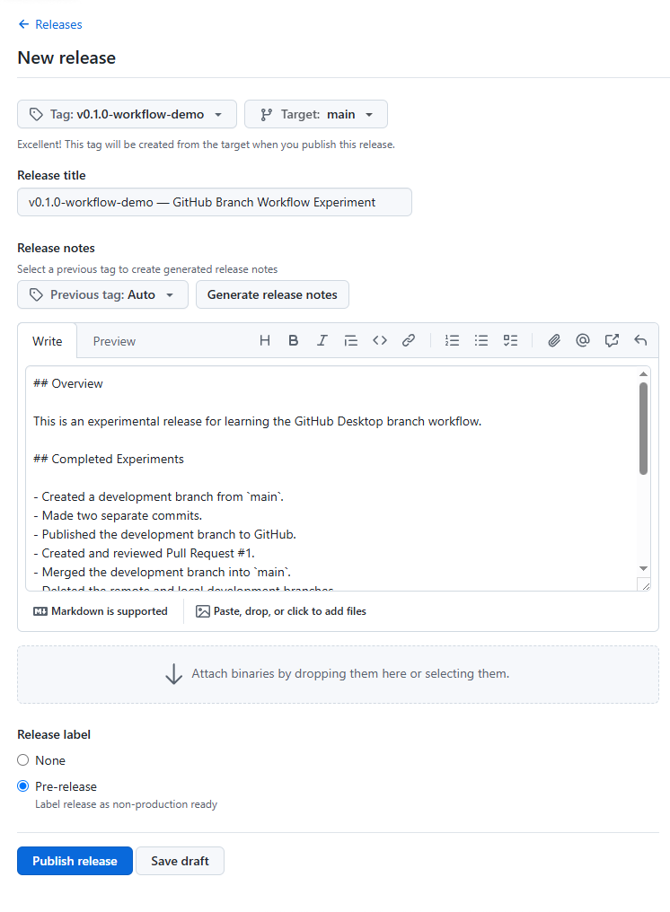

- Release title：`v0.1.0-workflow-demo — GitHub Branch Workflow Experiment`
- Release notes：说明实验流程、已验证结果、尚未整理正式教程。
- Release label：**Pre-release**，避免误认为正式学习文档已封板。
- 不把该教学实验版本设置为 Latest 正式版。

**Pre-release 不是私有发布**；公开仓库中的实验版仍然可见。

### 10.3 实际发布并验证 Tag

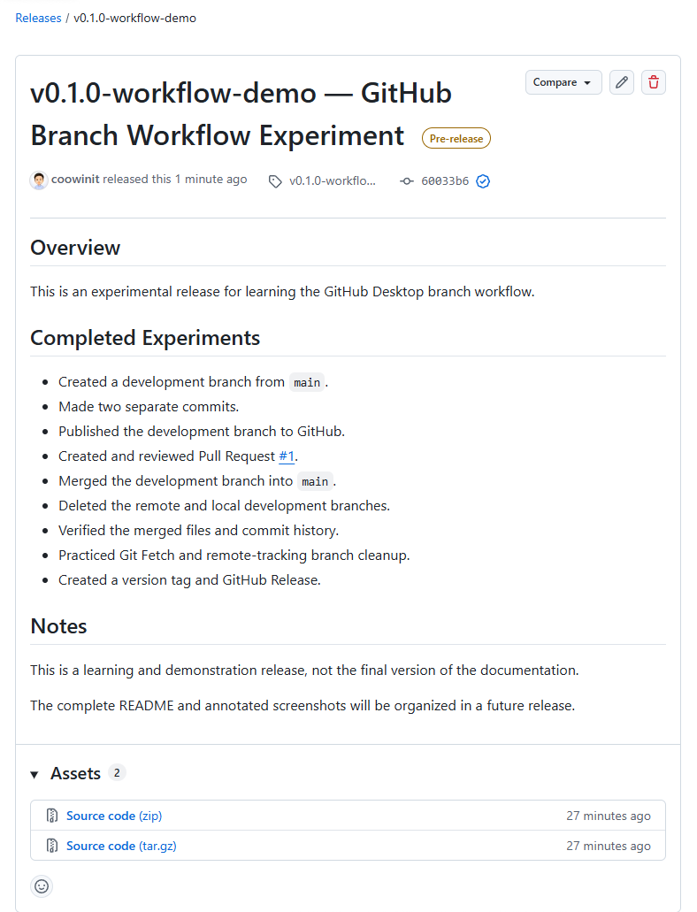

发布后 [v0.1.0-workflow-demo](https://github.com/coowinit/github-desktop-learning-guide/releases/tag/v0.1.0-workflow-demo) 对应 Commit `60033b6`，就是刚才的 Merge Commit。

**`Source code (zip)` 与 `Source code (tar.gz)`** 是 GitHub 根据 Tag 所指向提交自动生成的源码快照，不是你电脑实时工作目录，也不是自行上传的插件安装包。以后 `main` 再更新，该旧 Tag 的归档通常仍保持固定提交内容。

## 11. 九个核心概念对照

| 概念 | 一句话理解 | 常见误区 |
| --- | --- | --- |
| Branch | 指向 Commit 的可移动引用 | 新分支=完整复制一个仓库 |
| Commit | 在本地形成一条版本历史记录 | Commit=上传 GitHub |
| Fetch | 获取远端最新对象和引用 | Fetch 必然改写工作文件 |
| Pull | Fetch 后整合远端提交到当前分支 | Pull=提交或上传 |
| Push | 上传本地分支提交 | Push=合并到 main |
| PR | 请求将来源分支更改整合到目标分支 | 创建 PR 就完成 Merge |
| Merge | 整合分支历史和内容 | Merge=删除开发分支 |
| Tag | 通常固定指向指定 Commit | Tag 会随 main 前移 |
| Release | 基于 Tag 的正式/预发布记录 | Release 自动代表代码通过测试 |

## 12. 实际工作中的推荐流程

对于个人维护的 WordPress 主题、插件和轻量工具项目，建议采用简单、可维护的短期开发分支流程：

1. `main` Fetch/Pull，保证工作区干净。
2. 一个独立任务创建一个功能分支，例如 `feature/faq-dynamic` 或 `fix/mobile-menu`。
3. 小步 Commit，Summary 描述**做了什么**，必要时添加 Description。
4. 发布分支后创建 PR，检查 `Files changed`、测试结果和合并方向。
5. Merge 到 `main`，在目标分支验收实际页面或功能。
6. 删除远端和本地临时分支，Fetch 更新引用。
7. 汇总本阶段成果并更新 README，再创建正式 Tag 和 Release。

不需要为了每个 CSS 小调整都新建分支，也不需要为个人项目强行引入 `develop`、`staging`、`release/*` 等多级长期分支。

## 13. 容易犯的错误与风险

| 操作/误判 | 可能问题 | 建议 |
| --- | --- | --- |
| 只看 `0 changed files` | 忽略未 Pull/Push 的提交 | 同时检查同步状态 |
| 未确认当前分支就 Commit | 提交到错误分支 | 操作前看顶部 Current branch |
| PR 的 base / compare 选反 | 修改进入错误分支 | 检查 `base: main ← compare: feature` |
| `Able to merge` 就立即合并 | 自动合并不代表功能正确 | 检查 Files changed + 功能测试 |
| 误删未合并分支 | 独有提交可能失去引用 | 先验证 Merge/备份 |
| 把 `origin/foo` 当作 GitHub 远端本体 | 分支清理时混乱 | 区分本地引用和服务器分支 |
| 误用 Force push / Reset hard | 可能重写或丢弃历史 | 初学阶段避免作为常规同步方式 |
| Release 标记错误提交 | 发布包与预期不符 | 发布前核对 Tag、Target、Commit |
| 发布含私密数据的截图 | 造成隐私泄露 | 上传前检查邮箱、令牌与账号信息 |

## 14. 验收清单与命令速查

### 完整实验验收

- [x] 从最新 `main` 创建本地开发分支。
- [x] 在开发分支新增文件并执行两次 Commit。
- [x] Publish branch，在 GitHub 看到远端分支。
- [x] 创建 PR #1，验证 base / compare 方向。
- [x] 检查 2 Commits、1 Files changed、累计新增 26 行。
- [x] Merge PR，验证 `main` 已包含实验文件。
- [x] 删除 GitHub 远程开发分支。
- [x] 删除 GitHub Desktop 本地开发分支。
- [x] 理解并清理失效的 `origin/...` 引用。
- [x] 确认 `main` 干净、同步且 History 完整。
- [x] 创建实验 Tag 并发布 Pre-release。
- [ ] 上传最终 README 与全部真实截图，检查 GitHub 渲染。
- [ ] 完成正式文档验收后发布 `v1.0.0`。

### Git 命令辅助记忆

```powershell
# 当前分支和工作区状态
git status -sb

# 本地与远程跟踪分支
git branch -a

# 获取远端信息
git fetch origin

# 获取并清理失效的远程跟踪引用
git fetch --prune origin

# 展示提交关系（尤其适合复盘 Merge）
git log --oneline --graph --decorate --all -20

# 查看当前 main 相对 origin/main 的落后提交数
git rev-list --count main..origin/main

# 查看未推送提交数
git rev-list --count origin/main..main

# 查看当前标签
git tag --list

# 查看标签指向的提交
git rev-list -n 1 v0.1.0-workflow-demo
```

这些命令只用于辅助理解，日常依然可以通过 GitHub Desktop 完成大部分操作。

## 15. 截图索引与参考链接

全部 **29 张真实实验截图**位于 [`images/branch-workflow/`](images/branch-workflow/)。文件名以 `01` 至 `29` 编号，严格按学习过程排序，方便在 Markdown 中引用。

- [GitHub Desktop 官方文档](https://docs.github.com/en/desktop)
- [GitHub 关于 Pull Request 的文档](https://docs.github.com/en/pull-requests)
- [GitHub 关于 Releases 的文档](https://docs.github.com/en/repositories/releasing-projects-on-github)
- [Git 官方参考文档](https://git-scm.com/docs)
- [本次实验 PR #1](https://github.com/coowinit/github-desktop-learning-guide/pull/1)
- [本次实验 Pre-release](https://github.com/coowinit/github-desktop-learning-guide/releases/tag/v0.1.0-workflow-demo)

---

**一句话复习**：`main` 是整合主线；Branch 隔离任务；Commit 记录每次变更；Publish/Push 上传；PR 用于检查和申请合并；Merge 让代码进入主线；分支清理不删除已合并内容；Tag 固定版本位置；Release 对外发布该版本。
