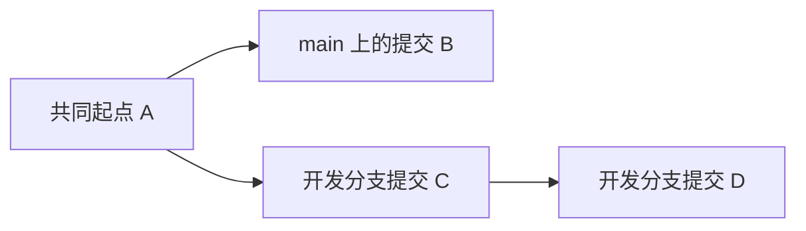
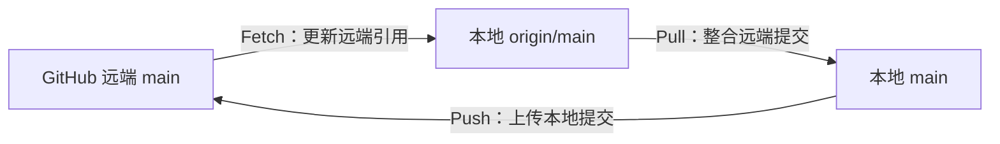
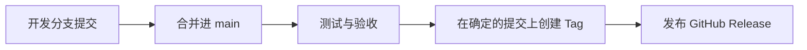

# GitHub 分支管理学习指南

> 从一张 GitHub Desktop 截图，系统理解 `main`、开发分支、Commit、Fetch、Pull、Push、Merge、Pull Request、Tag 与 Release。
>
> 案例仓库：[coowinit/wordpress-classic-theme-blueprint](https://github.com/coowinit/wordpress-classic-theme-blueprint)  
> 截图日期：2026-10-13  
> 文档性质：学习笔记 / 操作指南（不是对仓库实时状态的审计）


---

## 目录

1. [这张截图告诉我们什么](#1-这张截图告诉我们什么)
2. [分支是什么：先建立心智模型](#2-分支是什么先建立心智模型)
3. [本地与远程：分清四种位置](#3-本地与远程分清四种位置)
4. [Commit、Fetch、Pull、Push 的区别](#4-commitfetchpullpush-的区别)
5. [如何在 GitHub Desktop 创建并使用开发分支](#5-如何在-github-desktop-创建并使用开发分支)
6. [如何安全地合并开发分支到 main](#6-如何安全地合并开发分支到-main)
7. [Pull Request 与直接 Merge 的区别](#7-pull-request-与直接-merge-的区别)
8. [Tag、Release 与 Branch 的关系](#8-tagrelease-与-branch-的关系)
9. [结合本次截图的建议操作顺序](#9-结合本次截图的建议操作顺序)
10. [常见误区与风险](#10-常见误区与风险)
11. [辅助理解的 Git 命令](#11-辅助理解的-git-命令)
12. [自主练习与验收清单](#12-自主练习与验收清单)
13. [官方文档](#13-官方文档)

---

## 1. 这张截图告诉我们什么

| 截图区域 | 看到的内容 | 正确理解 | 不能据此推断 |
| --- | --- | --- | --- |
| Current repository | `wordpress-classic-theme-blueprint` | GitHub Desktop 当前打开的仓库 | 不能证明远程仓库内容已与本地完全相同 |
| Current branch | `main` | 当前检出的**本地工作分支** | 不能证明 `main` 是最新版本 |
| Default branch | `main` | 当前显示的默认分支 | 默认分支不等于禁止直接修改的受保护分支 |
| Recent branches | `phase-04.3-native-pages` | 最近使用过的分支 | 不能证明它尚未合并，也不能证明它已被推送 |
| Changes | `0 changed files` | 当前工作区无待提交的文件变化 | 不能证明无未推送提交、无待拉取提交 |
| Pull origin | `16 ↓` | 当前本地分支相对已知远程跟踪分支有 16 个待拉取提交 | 不是 16 个文件、16 个分支，也不必然是 16 次功能更新 |
| Last fetched | `22 minutes ago` | 最后一次获取远端信息的时间 | 不能保证此刻远端状态未发生新变化 |
| Branch 行右侧 | `2 hours ago` | 界面显示的相关历史活动时间 | 不能单凭时间判断最近合并、同步、发布了什么 |
| 底部按钮 | `Choose a branch to merge into main` | 以当前 `main` 为目标，选择其他分支合并进来 | 点击选择入口**不等于已经合并** |

**截图能确定的事实**：当前处于本地 `main`，工作区干净，存在最近使用的开发分支，已知有远端提交等待拉取。

**需要进一步核实的问题**：`phase-04.3-native-pages` 的提交是否已经合并到 `main`；本地/远程两个分支的提交图是否一致；是否存在尚未推送的其他分支提交。

## 2. 分支是什么：先建立心智模型

在 Git 中，Branch（分支）本质上是**指向某个 Commit 的可移动引用**。新建分支一般不会复制一个新的完整仓库。

- `main`：通常作为相对稳定的开发基线，适合通过验收的成果。
- `phase-04.3-native-pages`：本次截图中的阶段性开发分支名称，`phase-04.3` 表示项目阶段，`native-pages` 表示开发方向；这些含义属于团队命名约定，不是 Git 的特殊语法。
- `Commit`：保存某次更改及其历史关联的版本记录。
- `HEAD`：标记当前检出位置；一般指向当前分支。



以上是**未合并时的一种示意**，不是当前仓库的真实提交图。分支的关系由共同祖先及后续提交确定，而不是由分支名称确定。

分支之间的代码不会因为“都在同一个仓库”就自动互相进入；需要明确执行 Merge、Rebase、Cherry-pick 等操作。本教程主要学习 **Merge**。

### 创建分支与切换分支

- **创建分支**：从某个提交创建一个新的分支引用。
- **切换分支**：切换当前检出版本；GitHub Desktop 通常也会相应更新工作目录中的文件。
- **提交到分支**：Commit 记录在当前分支的历史上；提交不自动发布到 GitHub。
- **合并分支**：将来源分支的更改整合到目标分支；最终结果受提交历史、合并策略与冲突解决影响。

## 3. 本地与远程：分清四种位置

本例至少需要理解以下名称：

| 名称 | 所在位置 | 作用 |
| --- | --- | --- |
| `main` | 本地仓库 | 本机正在工作的主分支 |
| `phase-04.3-native-pages` | 本地仓库（截图显示的最近分支） | 本地阶段性开发分支 |
| `origin/main` | 本地保存的**远程跟踪引用** | 最近一次 Fetch 后，本地所知道的 GitHub `main` 状态 |
| GitHub 网站上的 `main` | 远程仓库 | GitHub 服务器实际保存的主分支 |

`origin` 是远程仓库的常见默认名称；不是 GitHub 的同义词。`origin/main` 也不是远程服务器本体，而是本地保存的远端状态记录。



**特别注意：** 上图为了教学做了简化。`git pull` 通常执行 Fetch 再根据配置进行 Merge 或 Rebase；GitHub Desktop 提供对应的同步操作。`git push` 是将本地相应分支的提交上传到远端，不是从文件管理器直接“复制文件夹”。

## 4. Commit、Fetch、Pull、Push 的区别

| 操作 | 通俗理解 | 是否更改本地工作分支 | 是否更改 GitHub 远程分支 |
| --- | --- | --- | --- |
| **Commit** | 将本机更改记录成一个版本 | 会增加本地提交 | 否 |
| **Fetch origin** | 获取远端最新状态及对象 | 通常不直接改动当前工作文件 | 否 |
| **Pull origin** | 将远端提交整合进当前本地分支 | 是（若有新内容） | 否 |
| **Push origin** | 上传本地分支提交 | 本地提交本身不因此改变 | 是（成功时） |
| **Merge** | 将另一个分支整合到当前目标分支 | 可能新增合并提交或快进 | 仅本地 Merge 时不会自动改变远端 |

### 理解截图中的 `16 ↓`

这表示 GitHub Desktop 已知有 **16 个远程提交（Commits）尚未整合到当前本地分支**。并非 16 个文件，也不是下载进度条。

可能出现这一状态的原因包括：

1. 在 GitHub 网站上合并过 Pull Request，本地尚未 Pull。
2. 通过别的电脑或工具向远端 `main` 推送了提交。
3. 其他协作者已向远端更新代码。

这些只是**可能原因**；截图本身不能判定是哪一种。

### `0 changed files` 为什么还能需要 Pull？

`0 changed files` 检查的是**尚未提交的工作区变动**；`16 ↓` 检查的是**本地与远端的提交差异**。它们描述不同维度，因此可以同时出现。

## 5. 如何在 GitHub Desktop 创建并使用开发分支

推荐按以下顺序：

1. 切换到 `main`。
2. 使用 `Fetch origin` 检查远端，并在需要时先 `Pull origin`。
3. 确认 `Changes` 中无未提交修改；若有，先提交、暂存（Stash）或谨慎处理。
4. 点击 `Current branch` → `New branch`。
5. 选择以最新 `main` 为基础，命名分支，例如 `feature-faq-dynamic`。
6. 切换到新分支后开发，按可回顾的阶段创建 Commit。
7. 使用 `Publish branch` 或 `Push origin` 将分支发布或更新到 GitHub。
8. 测试完毕，再考虑创建 Pull Request 或合并。

**命名建议**（仅是团队约定）：

- `feature-faq-dynamic`：新增 FAQ 动态化。
- `feature-inquiries`：询盘功能。
- `fix-mobile-navigation`：导航问题修复。
- `docs-branch-guide`：文档编写。

无需为了每一个 CSS 小改动创建分支。**一个可以独立开发、测试和验收的任务，对应一个短期分支**，即可满足大多数个人开发场景。

## 6. 如何安全地合并开发分支到 main

### 路径 A：GitHub Desktop 本地 Merge

适合个人小项目、变更已经审查且不需要线上 Pull Request 记录的情况。

1. 确认功能分支已完成测试，必要时先 Push 备份。
2. 切换 `main`。
3. `Fetch origin`，然后 `Pull origin` 使本地 `main` 尽量保持最新。
4. 确认工作区干净。
5. 点击 `Current branch` → `Choose a branch to merge into main`。
6. 选择来源分支 `phase-04.3-native-pages`（本例仅用于说明，**请先确认是否已经合并过**）。
7. 审查确认界面、待合并提交和潜在冲突，然后执行 Merge。
8. 本地测试 WordPress 主题的关键页面及功能。
9. 确认正常后点击 `Push origin` 更新远端 `main`。

**方向辨别**：`Merge phase-04.3-native-pages into main` 的目标是 `main`。反过来切换至开发分支再合并 `main`，目标则是开发分支。**当前分支决定合并目标**，切勿仅看来源分支名称。

### 路径 B：GitHub 网站 Pull Request（建议用于阶段性成果）

适合需要留下审查记录、独立验收、回顾合并过程的场景。

1. 在开发分支完成开发、Commit、Push。
2. 到 GitHub 网站创建 Pull Request。
3. 设置 **base: `main`**，**compare: 开发分支**。
4. 检查 `Files changed`、`Commits`，运行必要测试。
5. 确认后 Merge Pull Request。
6. 在 GitHub Desktop 切换 `main` 并 `Fetch origin` / `Pull origin`。
7. 验收通过后按需删除已合并的开发分支。

**重要：** 在 GitHub 网站 Merge PR 后，本地不会自动更新。截图中的 16 个待拉取提交可能属于此类情形，但不能直接据此认定。

### 合并冲突怎么办？

两个分支修改了同一处内容且 Git 无法自动整合时，可能出现 Merge conflict。不要盲目选择“保留全部”或直接覆盖。建议查看冲突位置、结合需求保留正确的代码、运行测试，再完成提交。合并后即使没有冲突，也仍应测试运行逻辑。

## 7. Pull Request 与直接 Merge 的区别

| 比较 | GitHub Desktop 直接 Merge | GitHub Pull Request |
| --- | --- | --- |
| 主要位置 | 本地仓库 | GitHub 网站 |
| 审查记录 | 较少 | 可保存 PR 说明和讨论 |
| 是否需远端功能分支 | 不一定 | 通常需要先推送分支 |
| 是否能检查文件差异 | 可以，需主动查看 | PR 界面集中查看 |
| 适用场景 | 简单、低风险、个人小任务 | 阶段开发、正式验收、多人协作 |

Pull Request 不是另一种 Git 分支；它是请求将一个分支的变更整合到另一个分支的**协作与审查流程**。

## 8. Tag、Release 与 Branch 的关系

| 概念 | 是否随新提交前移 | 主要用途 |
| --- | --- | --- |
| Branch，例如 `main` | 是 | 持续开发的版本线 |
| Tag，例如 `v0.6.1` | 通常不应移动 | 标记某个确定的提交 |
| GitHub Release | 与 Tag 关联 | 发布说明、附件与版本交付 |



本项目可继续采用“**开发 → 测试 → 合并 → 封板 → Tag → Release**”的流程。Tag 本身**不执行分支合并**；发布 Release 也不自动让本地工作分支保持同步。打标签前要确认标签指向的是准备发布的正确提交。

## 9. 结合本次截图的建议操作顺序

**以下是针对截图当时状态的建议，不代表现在仓库仍处于同一状态。**

1. **先不要直接合并** `phase-04.3-native-pages`：截图不能证明该分支尚未合并。
2. 查看 GitHub 仓库的 `Pull requests`（含 Closed/Merged）以及 `main` 的 Commits，确认近期是否合并过这个阶段分支。
3. 当前 `main` 显示 `0 changed files`，适合先点击 `Fetch origin` 更新远端信息；确认内容可信后，点击 `Pull origin` 获取 16 个待拉取提交。
4. 拉取后检查 `History`，确认本地 `main` 的提交历史已经更新。`16 ↓` 应随同步结果变化；若仍存在提示，进一步检查具体分支状态。
5. 再比较 `main` 与 `phase-04.3-native-pages` 的历史：若已合并，不需要再次操作；若未合并，先判断是否仍需纳入。
6. 后续新功能建议从最新 `main` 新建开发分支，阶段性成果通过 PR 验收后合并。

> **优先顺序口诀：先确认状态 → 再同步主线 → 再建立开发分支 → 开发测试 → 审查合并 → 发布版本。**

## 10. 常见误区与风险

| 误解或行为 | 为什么有风险 | 正确方式 |
| --- | --- | --- |
| `0 changed files` 就是与 GitHub 一致 | 还有提交层面的差异 | 同时看 Fetch/Pull/Push 状态 |
| `16 ↓` 是 16 个文件需要下载 | 箭头数字指提交数量 | 打开 History / 比较 Commits |
| 新建分支等于备份了代码到 GitHub | 分支可能只存在本地 | 必要时 Publish/Push |
| 切到 `main` 后执行 Merge，总能自动成功 | 可能冲突，也可能合并方向弄错 | 先检查当前分支、来源分支、差异 |
| GitHub 上合并了 PR，本地就最新 | 本地不会自动 Pull | 回到 `main` Fetch/Pull |
| 删除功能分支就丢失已合并的功能 | 完整合并的提交仍可从 `main` 访问 | 核对已合并后再清理分支 |
| 删除未合并分支肯定安全 | 未合并提交可能失去易于访问的引用 | 未确认前不要删除 |
| 分支名就是功能状态证明 | 名称不携带合并和测试证明 | 查看提交图、PR 与测试结果 |
| Tag 就是分支 | Tag 主要用于固定版本标记 | 发布版本时指定正确提交 |
| 直接把旧文件夹覆盖本地就等于合并 | 可能覆盖并丢失变更 | 通过 Git 提交和 Merge 管理历史 |
| 使用 Force Push 解决同步差异 | 可能重写远端已有历史 | 除非非常明确影响，否则避免 |

### 哪些操作需要特别谨慎？

- **Discard changes**：丢弃工作区变更，可能造成不可恢复的数据丢失。
- **Delete branch**：删除前确认提交是否已合并或另有可访问备份。
- **Reset / Rebase / Force push**：可能改变历史或远端引用；初学阶段无需作为日常同步手段。
- **Merge conflict**：不能仅以“界面无错误”为验收，应测试网站行为。

## 11. 辅助理解的 Git 命令

本章节仅供在 Git Bash / PowerShell 中辅助学习；日常操作继续以 GitHub Desktop 为主。应在仓库目录下执行。

```bash
# 查看当前分支、是否有未提交变动，以及与上游的差异提示
git status -sb

# 查看本地分支与远程跟踪分支
git branch -a

# 更新远程跟踪信息（不直接合并到当前分支）
git fetch origin

# 查看简洁提交图（可跨分支）
git log --oneline --graph --decorate --all -20

# 本地 main 相对于已获取的远端 main：还差多少提交
git rev-list --count main..origin/main

# 本地 main 比已获取的远端 main 多多少提交
git rev-list --count origin/main..main

# 查看开发分支相对 main 的新增提交（本地分支存在时）
git log --oneline main..phase-04.3-native-pages

# 查看两分支的改动文件概况
git diff --stat main...phase-04.3-native-pages

# 在本地 main 中判断分支 tip 是否已被其历史包含
# 如果返回 0：分支 tip 可从 main 到达；如果返回 1：不可到达
git merge-base --is-ancestor phase-04.3-native-pages main
```

**命令解释补充：** `main..other` 的右侧是希望找到的独有提交范围；`main...other` 在 `git diff` 中通常表示从共同祖先到 `other` 的变化。两点和三点在 `git log` 与 `git diff` 的语义并不完全相同，初学时应分开记忆。

上面的 `merge-base --is-ancestor` 是精确的**提交祖先关系**测试。如果 PR 采用 Squash merge 或 Rebase merge，功能更改可能已经进入 `main`，但开发分支的原 Commit 不一定是 `main` 的祖先。因此返回 1 **不等于功能一定没有合并**；还需查看 PR、文件差异与提交历史。

## 12. 自主练习与验收清单

建议建立一个不重要的测试仓库，避免在正式 WordPress 主题仓库里尝试删除和历史重写。

- [ ] 能解释 `main` 和 `phase-04.3-native-pages` 谁是当前分支、谁是最近分支。
- [ ] 能说出 `0 changed files` 与 `16 ↓` 为什么可同时出现。
- [ ] 能说出 `main`、`origin/main`、GitHub 网站 `main` 的区别。
- [ ] 能执行 Fetch，明白为什么它通常不改变工作文件。
- [ ] 能从最新 `main` 新建开发分支并切换。
- [ ] 能在开发分支修改文件、Commit、Push。
- [ ] 能创建 PR，分清 base 与 compare。
- [ ] 能说明 Merge 后为什么还可能要 Push 或 Pull。
- [ ] 能判断分支是否合并，而不是仅凭名字或“最近使用”。
- [ ] 能解释 Tag、Release 与 Branch 为什么不是同一件事。
- [ ] 能在正式 Release 前检查正确的提交位置。

## 13. 官方文档

- [GitHub Desktop：管理分支](https://docs.github.com/en/desktop/making-changes-in-a-branch/managing-branches-in-github-desktop)
- [GitHub Desktop：同步分支（Fetch、Pull、Merge）](https://docs.github.com/en/desktop/working-with-your-remote-repository-on-github-or-github-enterprise/syncing-your-branch-in-github-desktop)
- [GitHub Desktop：提交与检查更改](https://docs.github.com/en/desktop/making-changes-in-a-branch/committing-and-reviewing-changes-to-your-project-in-github-desktop)
- [GitHub Desktop：推送分支](https://docs.github.com/en/desktop/making-changes-in-a-branch/pushing-changes-to-github-from-github-desktop)

---

## 最后记住这五句话

1. **Branch 管开发路线，Commit 管每次版本记录。**
2. **Fetch 获取远端信息，Pull 更新本地分支，Push 更新远端分支。**
3. **工作区干净，不代表本地与远端同步。**
4. **先确认当前分支，才能保证 Merge 的方向正确。**
5. **开发分支负责试验，`main` 负责整合；Tag 与 Release 负责标记和发布可交付版本。**
